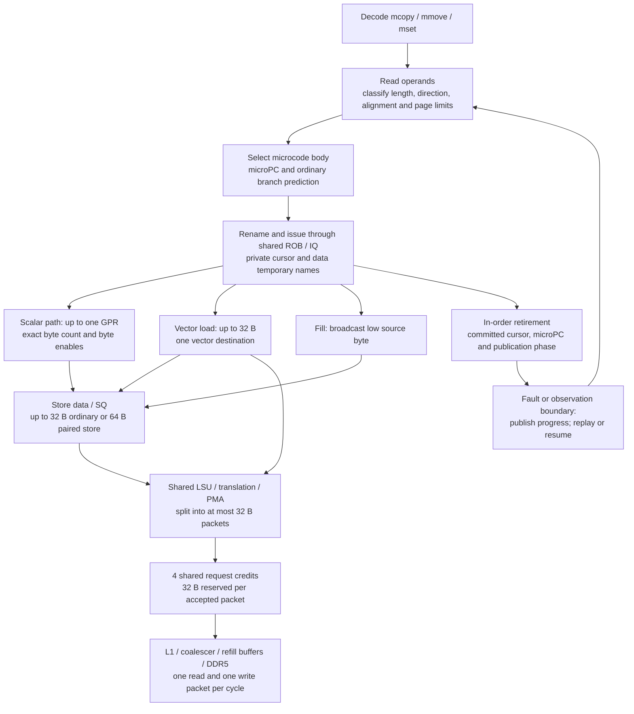

# Zimemops hardware feasibility and complexity

## Assessment and scope

The current implementation has a feasible mapping to an out-of-order core
with scalar/vector renaming, a split-access LSU and restartable microcode.
Its data movement is bounded. The main implementation work is control,
operand delivery and precise restart. Source inspection does **not** prove
that the modeled operations meet the configured 2 GHz clock or retain the
reported speedups after physical register ports and control latency are
implemented.

This assessment assumes an existing vector backend. On a scalar-only
core, supplying the vector register/LSU capability or replacing it with
serial scalar operations is a different area/performance tradeoff; the
current comparison does not establish a small implementation cost there.

This review covers the implementation committed with this document and
the measured RV64 configuration: VLEN=256, 32 B packets, four request banks,
`zimemops_bytes=64`, `zimemops_unroll=16`, active-length streaming and
`scalar_threshold=8`. Threshold zero is also enumerated below. Experimental
pair/quad schedules and other VLENs have different microcode layouts.
The source and existing results were checked on 2026-11-09. No RTL,
synthesis, place-and-route, power estimate or new performance sweep is
part of this review.

## Mapping onto the core

The diagram shows resource ownership, not pipeline stages. Loads write
the physical register file and stores consume those results. There is no
512 B bypass directly from memory to memory. The 512 B body contains
sixteen native loads and sixteen native stores, grouped into four-command
sub-batches. Four logical vector names are reused through renaming; older
physical versions can remain live while later sub-batches issue.

The existing RVV path provides unit-stride memory op classes, vector
register storage, split requests and byte masks. Zimemops provides its own
address/length generation and microcode schedule. Sharing the LSU does
not imply identical address logic, operand counts or store-data handling.
Architectural VL, VTYPE, vstart and the 32 architectural vector registers
are preserved; Zimemops does not execute a hidden `vsetvl`.

## Storage and data ports

| Item | Bound in the measured model | Main requirement |
|---|---|---|
| Scalar data | 8 B RV64 / 4 B RV32, `Ureg0` | Alignment, byte masks |
| Vector load | 32 B per micro-op | One vector result, split assembly |
| Ordinary store | 32 B per micro-op | One vector data source |
| Paired copy store | 64 B per micro-op | Collect two vector sources |
| Fill store | Up to 64 B | Byte broadcast and masks |
| Vector temporaries | Four internal names | Renamed physical versions |
| Private integer names | Two XLEN names, 16 B RV64 | Rename mappings |
| Physical pools | 256 integer + 256 vector | Shared capacity |
| Request staging | Four 32 B reservations | Credits and backpressure |
| Ordinary queues | ROB 192, IQ 64, LQ/SQ 32 each | Shared occupancy |

Scalar accesses need exact byte enables, including 3/5/6/7 B sizes on
RV64. An unaligned vector load can require two packet responses and
assembly into one result. Fills broadcast the low source byte without a
vector data source. Four temporary names hold 128 B at VLEN=256, but
overlapping renamed versions consume additional physical entries.

The 128 B request limit is enforced when a cache packet is accepted, and
the reservation survives squash until its response returns. Even a
one-byte ownership hint consumes a whole bank. Two split packets require
two reservations if both are outstanding. A four-entry tag table and a
0-to-4 occupancy counter can implement this policy; the C++ map of packet
pointers is simulator bookkeeping, not a required hardware associative
container.

This limit excludes completed load values, SQ payload, unsent split-store
data, partial load assembly, cache MSHRs, write buffers and refill storage.
For example, `SplitDataRequest::buildPackets()` creates store fragments
before every fragment has acquired a request credit. `SQEntry` stores
data independently, and `DynInst::memData` holds a request's assembled
payload. Their C++ allocation sizes are not physical area estimates.
A hardware design must assign these values to finite SQ/assembly storage
or retain source registers until consumption, with explicit backpressure.
Those buffers need not all duplicate the same data, but they cannot all
be charged to the four request banks.

The configured vector pool alone represents 256 x 32 B = 8 KiB of useful
register data at VLEN=256, before tags, ports, parity/ECC and wiring.
This is a common core resource, not new Zimemops storage. The two new
integer names do require mappings and committed state even though the
physical integer pool size is unchanged.

### Paired stores and register bandwidth

`storeStride == 2` is used in selected copy/fill bodies. `amount()` allows
two beats, and `write()` concatenates two vector values for a copy.
`LSQ::splitGrain()` then splits the request at 32 B boundaries. A full
64 B paired store takes at least two cache-send cycles, even on an L1 hit.
The aligned 512 B copy bodies themselves use `storeStride == 1`.
The generated move bodies do not use paired stores.

This has two practical implementations:

- Collect two 32 B vector operands into an existing SQ entry with two
  read paths, then drain it at 32 B/cycle.
- Collect one operand per cycle into that entry with one read path.
  Keep a second-source tag, per-half valid bits and a partially collected
  store state, and account for the collection cycles and scheduling.

Concatenation can be fixed wiring into two halves; it does not require a
general vector permutation network. However, gem5 currently obtains both
operands during one store execution without register-port arbitration.
One store micro-op also uses one ROB/IQ/SQ entry. Splitting it into two
hardware micro-ops changes those occupancies and retirement bookkeeping.
Neither a second port nor multi-cycle collection is validated by the
32 B cache-packet counters.

The stream constructor has room for six source operands: up to four
integer slots and two vector slots. Some integer slots are constant zero
or unused for a particular body. The ordinary RVV unit-stride store
constructor uses a base integer register, one vector data register and
an optional mask. Zimemops therefore needs an explicit operand-delivery
plan even on a core that already supports RVV.

The second-half source load has a dependency on the first-half load's
vector destination. Its value is not read. Hardware can implement this
as a ready-tag dependency without a 256-bit data read, but it still needs
a scheduler source tag and wakeup comparison. The implementation checks
no cache tag or hit/miss state when choosing this schedule. It reduces
duplicate outstanding requests during refills in the four-bank model;
other refill and credit policies can change its benefit.

## Control, address generation and microcode size

`ZimemopsLengths::select()` combines length classification, direction,
overlap, alignment, page bounds and ROM-target selection. `InitIssue`
can also compute an ending cursor. `Issue` subtracts the current group,
tests the next group and resolves a branch. These steps are assigned
`IntAluOp`, configured with a one-cycle functional-unit latency. That is
a modeling choice, not timing closure for the combined logic.

Most width-dependent arithmetic at 32 B can use bit slices, masks and
constant shifts. Page tests generally use 12-bit offsets. Full-width
pointer ordering, separation and count subtraction still need arithmetic
and comparison. A hardware implementation can pipeline classification,
split cursor update from branch resolution, or use a small control unit;
each choice must account for extra latency, state and issue bandwidth.

The normal forward address is `base + original - remaining + offset`;
reverse and peeled/end-cursor bodies have additional alternatives.
This is more than an ordinary `base + immediate` AGU input. Computing
an invariant endpoint once can simplify later address generation, but
requires explicit storage, operand delivery and recovery handling.
Repeated C++ helper calls execute within one simulated micro-op; they do
not allocate extra ALU cycles, AGUs or physical register read ports.
`DynInst::getRegOperand()` accesses the register file directly.

The microcode is finite and independent of runtime copy length. An
isolated enumeration of the unchanged `Zimemops` constructor, substituting
metadata-only objects for the emitted micro-ops, gives:

Entries below are shown as normal entries + byte-replay entries = total.

| Instruction | Scalar threshold 0 | Scalar threshold 8 |
|---|---:|---:|
| `mcopy` | 597 + 8 = 605 | 602 + 8 = 610 |
| `mmove` | 243 + 8 = 251 | 248 + 8 = 256 |
| `mset` | 202 + 6 = 208 | 205 + 6 = 211 |

These are generated static entries, including variants that dispatch may
not reach for a given operation. They are neither simultaneously resident
ROB entries nor a synthesized ROM size. The 512 B body contributes four
variants: loop, final, initial loop and initial final. Hardware can share
templates and bind architectural register numbers at decode instead of
replicating ROM per instruction encoding.

For scale only, storing all 1,077 threshold-eight entries separately at an
assumed 64-128 bits per entry would use about 8.4-16.8 KiB. That arithmetic
excludes selector tables, decode, read ports, ECC and physical layout;
the entry format has not been designed. Template sharing may reduce it.
The replay microPC starts at 1024, so this encoding needs at least 11 bits
to represent the normal and replay positions, plus instruction identity
and any phase information not reconstructed from the ROM.

The simulator reuses its macro/micro-op fetch machinery; hardware still
needs a ROM/sequence source capable of feeding the intended front-end
width. It also needs branch targets containing a microPC. Folding the
microPC into the existing predictor index consumes shared predictor
capacity, while storing and restoring microcode targets requires target
metadata. The configured four-wide front end and shared BPU do not prove
that this ROM/target path has the same physical access time as normal
instruction fetch.

## Precise progress, faults and memory ordering

The progress mechanism is feasible but has the highest correctness and
verification burden. Default stores do not publish a GPR result after
every beat. The committed cursor, microPC and fixed store ordinal identify
the completed prefix. A fault is before its store; an observation after
retirement is past it. Read batches, peeled heads, paired stores and
publication phases require different progress calculations.

Normal completion uses separate one-result pointer/count micro-ops.
A single-command terminal store can itself produce the zero count and
then publish pointers using the saved initial length. This store needs
an integer-result path as well as its SQ action. The model's one-result
bound does not establish the availability of that physical path.

At an interrupt, fault, debugger stop or PC event, `synchronizeState()`
directly reads and writes thread registers. This is a functional simulator
callback, not a timed sequence of PRF accesses. Implementing it in
hardware requires a recovery protocol, for example:

1. Select the committed micro-op boundary, block new issue as needed and
   settle or squash younger work. Keep already committed stores ordered.
2. Decode the completed prefix from the committed cursor and ROM phase.
   Read the corresponding committed operands, not speculative versions.
3. Publish source, destination and count through available write ports,
   with phase tracking to prevent a repeated stop from applying progress
   twice. Do not expose partially published state to a handler or debugger.
4. Resume the saved microPC only with coherent operand/data state, or
   discard speculative work and restart the remaining operation after
   publication. Include this latency in interrupt/recovery measurements.

Forward rebasing preserves `(base + done) + (count - done)`, so previously
computed endpoints remain valid. Backward moves retain their low bases
and reduce the remaining count. This invariant explains the model's
resume behavior; it does not make multiple hardware register writes
instantaneous. The fault path waits for outstanding committed stores,
and O3 interrupt handling waits for the instruction list to drain.
Debug/observation callbacks also need a coherent hardware snapshot.

Every memory micro-op uses ordinary translation, PMP/PMA and LSQ ordering.
Split requests finish their translations before entering the ordinary
store path; partial translation faults are permitted to issue only load
fragments. Wide faults request byte replay after publishing committed
progress. Uncacheable/device ranges and non-memory physical addresses
are rejected before the data access; hardware needs equivalent physical
attribute/range checks. The per-byte C++ physical-address loop is not a
specification for dozens of parallel hardware comparators.

`SplitDataRequest::initiateTranslation()` submits the fragments in a C++
loop. The cache-port limit does not limit DTLB lookup ports or prove their
latency. A hardware LSU must schedule those lookups. Likewise, ordinary
SQ-to-load forwarding bypasses the accepted-cache-packet counters and
needs its own port and alignment budget. Both paths are shared with RVV,
but their physical bandwidth is not established by the request-bank audit.

Overlapping moves keep the required direction and use ordinary
store-to-load forwarding or replay. A complete `mcopy`/`mmove`/`mset` is
not atomic: other agents can observe partial progress, and the 64 B
paired store is not a new 64 B atomic operation. Outstanding request
credits must remain allocated after squash until responses are consumed.
The shared one-bank store reservation requires an age/ready check and
fair arbitration; it reserves capacity only for eligible older stores.

Ownership hints use a non-faulting one-byte `PF_EXCLUSIVE` request, with
normal port/bank accounting and physical-memory checks. A miss can still
cause a whole-line ownership/coherence transaction. Partial stores need
old line data; complete-line write coalescing needs coverage tracking and
buffering in the cache. This common WriteAllocator behavior is enabled
for scalar, RVV and Zimemops. It is not a free one-byte memory operation
or a private Zimemops cache. The single-core tests do not validate a
multi-core coherence implementation or its traffic cost.

## Evidence and remaining implementation work

The current `mem.cc` SHA-256 matches the recorded completion audit:
`6e3c465a32cd9c11f39437798e735f4d44afc6a2522351070a43e7ba7247c9fd`.
This review rechecked all 1,280 stored ROI rows: peak accepted read/write
traffic is at most 32 B/cycle each, and peak request reservation is at most
128 B. It also checked the 72 successful stored validation records and
enumerated the constructor layouts above. Enumeration checks emitted
metadata, not instruction semantics or RTL timing. The existing tests
were not rerun for this documentation change.

The committed [hardware audit](report/hardware-feasibility-audit.json)
records the source and input-artifact hashes, constructor counts and
resource-check results.

The recorded functional coverage includes 10,718 cases per model,
RV32/RV64 PMP/restart tests, scalar on/off, alternate widths/schedules,
periodic state publication, timer interrupts and vector-state preservation
across O3, AtomicSimpleCPU and TimingSimpleCPU. This supports architectural
behavior and sampled recovery boundaries. It is not exhaustive formal
verification of every microPC, fault interleaving or physical alias.

Relative to the assumed RVV core, width/mask adapters and request-credit
control are modest additions. Paired-store operand collection and ROM
integration are moderate changes. Precise retirement/restart integration
has the largest verification burden. PRF port additions could dominate
area and timing if existing ports cannot deliver the operands. These are
qualitative engineering assessments, not measured gate or power counts.
The remaining work is:

| Area | Required hardware validation |
|---|---|
| Data movement | Finite SQ/assembly storage; PRF and forwarding ports |
| Length/AGU logic | Critical-path synthesis; pipeline and operand budget |
| ROM/front end | Encoding, read bandwidth and microPC target storage |
| Precise restart | Timed FSM; store/publication boundaries and squash races |
| Cache ownership | Finite coalescer/refill buffers; multi-core coherence |
| Area/power/clock | Synthesis and physical design in the chosen process |

The strongest performance claim remains the measured matrix: 128/128
wins against its best-RVV envelope, with 1.2873x positive-length geometric
speedup. Warm 4096 B offset zero takes 129.0625 cycles versus 129.140625
for RVV, a margin of only 0.078125 cycles per call. The ideal copy payload
bound from the independent 32 B read/write ports is 4096/32 = 128 cycles,
before overhead. Such nearly saturated cases can tie or change order
when hardware costs are included. No hardware-wide or workload-wide
strict win follows from these results.

A next hardware-oriented evaluation should budget scalar/vector PRF
ports, serialize paired-store operand collection where necessary, give
classification/AGU logic an implementable pipeline, and charge recovery
publication cycles. Apply the same physical budgets to scalar and RVV,
then repeat the length/offset/warm/stream and LMUL matrix. Prototype RTL
for the selector, store collector and recovery FSM is needed before
assigning area or promising the present frequency and margins.

## Source anchors

- [Memory microcode](../../src/arch/riscv/insts/mem.cc):
  `ZimemopsLengths`, `ZimemopsStream`, `ZimemopsPrefetch`, constructor ROM
  generation and `synchronizeState()`.
- [Integer names](../../src/arch/riscv/regs/int.hh) and
  [vector names](../../src/arch/riscv/regs/vector.hh): private state and
  reused internal data registers.
- [LSQ](../../src/cpu/o3/lsq.cc) and
  [LSQ unit](../../src/cpu/o3/lsq_unit.cc): request splitting, translation,
  credit lifetime, response throttling, arbitration and forwarding.
- [SQ storage](../../src/cpu/o3/lsq_unit.hh) and
  [register operands](../../src/cpu/o3/dyn_inst.cc): data storage and
  functional register-file access.
- [O3 commit](../../src/cpu/o3/commit.cc),
  [fault replay](../../src/arch/riscv/faults.cc) and
  [PMA checks](../../src/arch/riscv/pma_checker.cc): recovery and access rules.
- [TLB](../../src/arch/riscv/tlb.cc): physical-memory range checks and
  wide-fault conversion.
- [RVV templates](../../src/arch/riscv/isa/templates/vector_mem.isa):
  ordinary unit-stride micro-op source operands.
- [Benchmark configuration](se.py), [runner](run.py),
  [validator](validate.py) and [results description](README.md):
  shared resource parameters, measurement checks and existing coverage.
