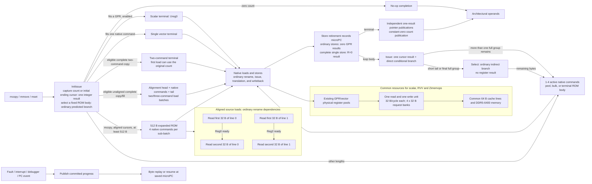

# Zimemops: bounded descriptor model and memcpy comparison

Draft `mcopy`, `mmove` and `mset` expand into bounded scalar/vector micro-ops
using the existing register pools and LSU. Aligned copies issue the first
32-byte load of each source line before its dependent second-half load,
reducing duplicate request-bank occupancy during refills. A 512-byte expanded
body reuses four temporaries per sub-batch to reduce control overhead, with
ownership hints for partial destination lines. The committed microPC and
private cursor preserve progress across faults, interrupts and debugger
stops; architectural vector state is unchanged. `--reference` retains the
per-beat architectural-register microcode for controlled comparisons.

Validation passes 72 cross-model/configuration suites, including 10,718
functional cases per model. The single-core RISC-V O3 DDR5-6400 comparison
covers 1,280 ROIs with scalar, eight RVV kernels and Zimemops. Zimemops wins
all 128 length/offset/warm-stream scenarios against the fastest RVV kernel
per scenario; positive-length geometric speedups are 1.2873x versus that
RVV envelope and 2.9963x versus scalar. The committed key data, figures
and exact resource limits are documented below.

The [hardware feasibility review](HARDWARE.md) maps this model to hardware,
including register ports, paired stores, microcode storage and precise
restart. It distinguishes checked resource bounds from unmeasured RTL
timing, area and recovery costs.

The ISA semantics follow draft Zimemops v0.1 at
<https://github.com/wangpc-pp/riscv-isa-manual/tree/main-zimemops>, revision
`dec8093ba2758b096f8844e2df4a443c08e29be7`. Add `"Zimemops"` to the ISA's
`extra_extensions` to enable it. The draft extension is disabled by default.
The earlier 256-byte single-micro-op prototype and its 1.448x result do not
establish performance at this hardware budget.

## Resource budget

All memcpy implementations use the same O3 core and LSU configuration:

| Resource | Budget |
|---|---|
| Core | One RISC-V O3 core, 2 GHz, four-wide coupled front end |
| Queues | ROB 192, IQ 64, LQ 32, SQ 32 |
| Vector state | VLEN 256, 256 physical vector registers |
| Memory issue units | One read, one write; no shared RdWr unit |
| Cache request ports | One read packet and one write packet per core cycle |
| Request/return beat | At most 32 bytes; read return throttling enabled |
| Shared request staging | Four 32-byte banks, 128 bytes total |
| Load/store scheduling | Reserve one bank for ready older stores |
| Caches | 32 KiB L1I/L1D, 256 KiB L2, 64-byte cache lines |
| Memory | DDR5-6400 DIMM, 2 x 32-bit channels, 512 MiB address range |
| Prefetch | Disabled for the primary comparison |
| Write coalescing | Same WriteAllocator enabled for all methods |

`lsqDataBufferSlots` and `lsqDataBufferSlotBytes` define staging capacity.
The benchmark sets them to 4 and 32. Each accepted cache packet reserves a
bank until its response returns, including after a squash. Misaligned
accesses use multiple packets/banks. This conservative transaction-level
reservation model limits in-flight request data as well as storage.

The 128-byte budget covers shared LSU request staging. Existing physical
register and ordinary SQ storage are common to all methods. Completed loads
write the physical register file. Zimemops uses up to four native vector-register
temporary names on the vector path; their renamed versions consume the same
256-register budget as RVV. The scalar path reuses the existing internal
integer name `Ureg0`, with renamed versions in the common integer register
pool. It does not increase either physical register pool. Renaming permits
another group to load before previous stores finish.
No register holds a free 256-byte payload, and LSU staging limits still apply.

Some copy/fill bodies combine two native beats into one store micro-op.
That operation can supply 64 B to the SQ and, for copies, read two vector
registers. The LSU sends it as two packets of at most 32 B on separate
cycles. Thus the packet limit does not establish a 32 B store-data path or
a single vector read port. The 128 B staging budget excludes SQ data,
split-request assembly, cache refill storage and physical registers; see
the [storage and port analysis](HARDWARE.md#storage-and-data-ports).

`lsqStorePriority` is an optional global scheduling policy. It remains off
for all primary runs; `--store-priority` enables it for every method. Earlier
results enabled it and incorrectly treated its overlap penalty as an inherent
Zimemops cost. `--no-store-priority` is accepted as an explicit off control.

The common WriteAllocator uses `coalesce_limit=0`, `delay_threshold=4`, and
`no_allocate_limit=1<<30`, preventing write-no-allocate transitions at these
test sizes. RVV can also combine adjacent partial stores. `--no-coalesce`
disables write coalescing for all methods.

Every performance run asserts `peakLoadBytesPerCycle <= 32`,
`peakStoreBytesPerCycle <= 32`, and `dataBufferPeakBytes <= buffers*64`.
These measure accepted cache packets and reserved staging banks; packet
splitting alone is not evidence of the per-cycle bandwidth limit.

## Descriptor execution and hardware cost

### Microarchitectural flow



The default path selects fixed ROM bodies by the effective byte count,
following RVV's use of VL to avoid inactive memory micro-ops. Regular bodies
contain one to four native commands; complete tails may use five. Aligned
forward copies also use a 512 B expanded body in the default configuration,
with four load/store commands per sub-batch. Each sub-batch reuses at most
four internal vector temporaries through the ordinary O3 rename machinery
and shared physical-register pool. The 512 B span describes work covered by
the ROM body; requests remain bounded by the existing 32 B pack grain and
four 32 B request banks. Architectural VL, VTYPE, vector registers and
vstart are preserved. The simulator reuses its microPC/fetch machinery and
physical register pools. Hardware still needs ROM selection, sequencing
and recovery control; these are not zero-cost operations.
Each selector/cursor update is an ordinary integer micro-op. Select produces
no register result; other ordinary micro-ops produce at most one result.
This bounds result count, not combinational depth or source-port demand.

Entry reads destination, source (except fill), and count for body/page
selection. Mmove retains the direction/overlap dependencies.
Counts fitting one command use the existing single-command terminal body.
With `--scalar-threshold 8`, RV64 counts up to eight bytes may use `Ureg0`;
RV32 caps this at four. The default scalar threshold is zero.

Complete non-overlapping copies of up to two native commands can use a
separate terminal body when its first destination beat fits an alignment
fragment and its page bounds permit completion. Its first load precedes
all stores and addresses the original source, so it may read the original
count without waiting for InitIssue's private cursor result. Later loads
and every store retain the captured cursor for repeated publication. A
single-command forward load also has no destination-address dependency.
All memory accesses remain within the requested byte range.

Forward copies/fills longer than two native commands and within the
four-command capacity can fold an unaligned head into a complete terminal
body when the destination page permits completion. The first command stops
at the native-width boundary; following commands are aligned to that width.
The exact byte count selects three to five active commands, including the
head and tail. Destinations in the first half of the alignment line use
two-command load/store batches; those in the second half use three, bringing
the first complete destination line's stores into the same batch. These
batches consume at most three ordinary vector temporaries, within the
existing four-register/128-byte budget. Stopped/faulted bodies derive progress
from the peeled first-command length and committed microPC.

Unaligned two-command entry bodies alternate loads/stores and use ordinary
ownership hints for partial destination lines. Matched source/destination
alignment permits a different load order: in a four-command sub-batch the
first halves of two source lines issue as commands 0/2, then their second
halves as 1/3. A second-half load has a rename dependency on its first-half
load's vector destination. The peer value is not read or combined. Once that
result is ready, the source line's refill has completed, allowing the peer
request to use the filled cache line instead of holding a second request
bank during the same refill. This reads no cache tag/state and consumes the
same read port, write port, request banks and register pool as RVV.

The expanded copy body is capped at `min(window_bytes, 16 * command_bytes)`:
512 B with the measured parameters. It uses this same four-command load
order and stores each sub-batch before reusing its logical temporaries.
Two-command batches use the same peer dependency when applicable. The first
window can compute its ending cursor in InitIssue; later windows retain an
ordinary one-result Issue and direct loop target. This reduces intermediate
cursor/selection and branch overhead without increasing data staging.

Three-command finals and eligible source-aligned five-command tails hint
the partial final destination line after their first load. When an initial
alignment head will be followed by an expanded body and source/destination
relative alignment matches, its hint is omitted. This saves a warm read
issue slot while the peer-load schedule provides enough overlap for stream
copies. These choices depend only on addresses and lengths. A tail hint also
publishes the already completed prefix when explicitly stopped; rebasing
both pointers and count preserves in-flight addresses. Overlapping moves
retain the original directional/page/alignment policy, and fills omit loads.

Each loop body's Issue uses a fixed direct target for regular full groups.
Only its final group or limited fragment executes Select. Its suffix is
nonempty on the committed path, so Select is unconditional. This avoids
alternating the regular loop's indirect target between bulk and terminal
bodies. Tail bodies contain only the active loads/stores and publication.
The final full group uses a terminal body too, avoiding an extra loop end.
Both branch kinds share the ordinary BPU. MicroPC is folded into the lookup
key so different microcode branches consume distinct entries from that
same capacity; architectural addresses and predicted targets stay real.

The default window is capped at four native commands (128 B at VLEN=256),
even if the decoder requests a larger window. Large copies use two-command
groups to expose stores earlier. Smaller configured windows
retain their cap. `--pair-control` and `--quad-batch` retain the legacy fixed
window schedules as explicit experiments; the default uses active-length
bodies. Neither mode widens requests or changes resource budgets.

The two added issued and remaining scalar names represent 16 B of logical
state at RV64 and require rename-map entries in the existing integer pool.
The default path updates only the issued cursor;
legacy schedules retain the remaining-counter result. Up to four existing
internal vector names supply native data in the common physical pool.
The scalar path uses existing `Ureg0`. Immutable dispatch metadata adds ROM
entries, with no per-copy payload or separate register pool. The effective
default loop window is at most four native commands (128 B), even though old
`window_bytes` fields record the requested decoder window.

Ordinary default stores have no GPR result, matching RVV stores. At a stop or
fault, the committed microPC and fixed command ordinal identify the completed
stores. A fault is before its store; a stop after retirement has advanced
past it. Read batches count only the stores preceding that batch. This
reconstructs the exact progress from the issued cursor without writing a
GPR on every native store. Atomic and Timing CPUs use the same fixed ROM
positions after their successful accesses/responses.

Complete single-command entry bodies use an ordinary one-byte exclusive
prefetch for the partial destination line. It uses the common read unit,
cache port and request bank, has no register result, and suppresses faults.
Zimemops PMA/physical checks prevent MMIO or pseudo-op accesses. The real
load/store still checks permissions and transfers the requested bytes.
Zero count predicates all these accesses false. Cache prefetchers remain
disabled; this ownership hint is part of the instruction implementation.

For a complete single native store, its one integer result publishes R=0.
Two subsequent one-result ALU micro-ops publish the pointers from the saved
original count. At a stop after that store, rebasing the endpoint seed to
zero preserves `(P + N) + 0 = P + N` and prevents repeated advancement.
Other terminal bodies publish source, destination and constant-zero count
with three separate one-result ALU micro-ops (two for mset). Mmove retires
source before destination to preserve direction.

Aligned power-of-two commands may cross a page between beats. Unaligned
terminal destinations retain page caps; irregular widths conservatively
cap both source and destination. Wide faults publish prior committed
progress, then use byte replay to identify the first faulting byte. Equal
addresses still access memory. Backward mmove follows the draft rule whenever
destination exceeds source, including non-overlapping moves.

Stops publish committed progress rather than an issue-ahead cursor. Forward
publication preserves `(D + K) + (R - K) = D + R`, keeping in-flight addresses
and completion endpoints unchanged after rebasing. Backward publication
leaves both low bases unchanged. Publication phases avoid applying progress
twice. Repeated stops resume at the saved microPC; memory/cursor/control
micro-ops provide interrupt points.

RTL synthesis, area, critical-path timing, and physical register-port costs
remain unmeasured. Normal completion uses separate one-result publications;
stop/fault synchronization directly updates thread state in the simulator
and needs a timed recovery mechanism in hardware. The
[hardware review](HARDWARE.md) documents these implementation requirements.

`lsqStoreReserveSlots` defaults to zero in the general core. The benchmark
uses one: an eligible older unsent store retains the last free request
bank against younger loads. It does not add capacity or reserve for stores
still waiting for data/retirement. The same policy applies to every method;
`storeReserveStalls` distinguishes it from strict priority/capacity delays.

## Short-path optimization and measurement

The short path is available with `--scalar-threshold 8`. The common
PublishR dependency removal also applies with threshold zero. All variants
use the resource budget above.

### Benchmark correction

The old hot loop calculated `(r % slots) * stride` for every copy. Disassembly
confirmed a `remu` even when warm mode used `slots=1`; the old 1-byte ROI
committed 256 IntDiv operations for 256 copies. Two non-pipelined, 20-cycle
dividers impose a throughput bound of about 10 cycles/copy. Consequently, the
old flat results near 10.74 cycles/copy hid short-kernel changes.

Warm mode now calls each kernel with fixed pointers. Stream mode increments
and wraps the pointer offset. These changes apply to every scalar, RVV and
Zimemops kernel, and `run.py` requires zero committed IntDiv operations in
every ROI. It continues checking data, staging capacity and read/write
bandwidth. The Zimemops wrapper also relies on the instruction's zero-count
semantics instead of adding a second zero-length branch; the reference and
optimized simulators execute exactly the same updated workload binary.

Earlier cycle tables used the old loop/wrapper. They are archived separately
and must not be mixed with the corrected measurements.

### Current DDR5 results

The updated measurement contains **1,280 ROIs**: scalar, eight fixed RVV kernels,
and Zimemops, each at sizes 0, 1, 8, 16, 32, 33, 64, 65, 128, 129, 256,
512, 1024, 4096, 16384 and 65536 B; offsets 0/1/31/63; warm and stream.
The positive-length comparison contains 120 distinct scenarios. The scalar
threshold is eight. Warm makes two preliminary copies; stream visits
different slots in the original 1 MiB arrays. All arguments still total
128 B and every kernel uses the same workload executable.

| Reference | Geometric speedup | Wins / positive cases |
|---|---:|---:|
| Scalar | 2.9963x | 120/120 |
| Fastest fixed RVV: align m8 | 1.5167x | 120/120 |
| Best RVV per scenario, all eight kernels | 1.2873x | 120/120 |

Including the eight zero-length scenarios, Zimemops wins **128/128** against
the fastest of the eight RVV kernels in each scenario. Wins are strict:
ties would fail the completion audit. All 1,280 actual hardware configurations
match, both sides use the same simulator and workload binaries, and two
independent Zimemops sweeps reproduce all 128 cycle counts exactly.

The smallest advantage is warm 4096 B offset 0:
129.0625 versus 129.1406 cycles/copy, approximately
0.060% fewer cycles. The results establish the measured matrix; they are not
a claim of a universal win for all workloads or hardware implementations.

Warm geometric speedup versus the per-scenario RVV envelope is
1.1362x; stream is 1.4585x, with 60/60 wins in each mode.

| Mode | Bytes | Offset | Scalar | Best RVV kernel | RVV | Zimemops |
|---|---:|---:|---:|---|---:|---:|
| warm | 0 | 0 | 6.2109 | rvv | 5.2109 | 4.2500 |
| stream | 64 | 0 | 200.1055 | rvv-m1 | 132.4922 | 116.8477 |
| stream | 65 | 0 | 284.4492 | rvv-m2 | 246.3555 | 168.0078 |
| stream | 128 | 0 | 391.8555 | rvv | 186.5195 | 165.4336 |
| stream | 129 | 0 | 461.5625 | rvv-align-m2 | 377.5195 | 246.8516 |
| warm | 1024 | 1 | 151.3984 | rvv-align-m4 | 34.4883 | 34.4570 |
| warm | 4096 | 0 | 514.8594 | rvv-align-m8 | 129.1406 | 129.0625 |
| stream | 65536 | 0 | 195229.5000 | rvv-m2 | 89598.7500 | 66705.5000 |
| warm | 65536 | 31 | 74741.7500 | rvv-align-m1 | 16122.2500 | 13457.7500 |

### Scheduling and measured effects

The load dependency changes request-bank residence rather than cache or
memory capacity. Aligned stream 128 B now takes 165.4336 cycles/copy versus
186.5195 for RVV m4. Aligned stream 64 KiB takes 66,705.5 versus 89,598.75
for RVV m2. The expanded body also reduces branch overhead in warm copies.
The 64 B complete body and 65/129 B partial-tail hints remove the remaining
short-stream gaps; the conditional head hint removes the final warm 1 KiB
gaps. The completion audit retains every scenario and its exact best RVV
kernel, including the small warm margins.

Several alternatives were measured and rejected: gating stores on both
load results, changing shared bank arbitration, removing ownership hints
unconditionally, and changing the predictor key. Their data remain local.
The retained design uses only bounded native requests and ordinary register
dependencies, with no cache-state-dependent dispatch or larger data buffer.

### Plot and data outputs

`plot.py --three-way --lmul` exports the primary fixed-kernel comparison,
latency, a <=256 B latency enlargement, and separate m1/m2/m4/m8 plots
for plain and destination-aligned RVV. Every figure is divided by mode and
offset, with PNG and standalone SVG versions. Tables/CSV retain zero length;
logarithmic figures show positive lengths. `case-comparisons.json` lists
both fixed-kernel and per-scenario speedups, including any loss or tie.
`all-case-comparisons.json` also includes zero length, and
`completion-audit.json` records coverage, hardware equivalence,
repeatability and validation evidence.

The committed primary figures compare scalar, Zimemops and RVV LMUL
1/2/4/8 for every warm/stream and offset combination:

- [Plain RVV LMUL comparison](report/comparison-lmul.svg)
- [Destination-aligned RVV LMUL comparison](report/comparison-lmul-aligned.svg)

The following committed artifacts are the minimal evidence set behind the
figures and claims:

- [Complete CSV rows](report/results.csv): all 1,280 measured ROIs and
  counters in a reviewable format below the repository file-size limit.
- [Per-scenario comparison](report/all-case-comparisons.json): the scalar,
  best-RVV and Zimemops result for all 128 scenarios, including zero length.
- [Aggregate summary](report/summary.json) and
  [completion audit](report/completion-audit.json): per-kernel speedups,
  win counts, worst case, repeatability and resource checks.
- [Validation records](report/validation.json): all 72 functional,
  trap/restart, interrupt and configuration suites.
- [Build and hardware provenance](report/provenance.json): simulator,
  workload, binary and measured configuration hashes and parameters.
- [Hardware feasibility audit](report/hardware-feasibility-audit.json):
  reviewed source hashes, generated microcode counts and rechecked limits.

The SVG figures are derived from the same measured rows. The standalone
raw JSON, PNG duplicates, exploratory alternatives and intermediate
experiment data are not versioned and can be regenerated with the commands
below. The hardware audit records the raw JSON input hash.

Simulator SHA256:
`b10a549ffe295366ab0d0aeff342bc0994f8c016c8a74723d533698f927d323a`.
Common performance workload SHA256:
`81dfd3f57571674082b70be7d60f6956335c4e74d1ae0df7eaa276e8470403ea`.
The scalar/RVV references and Zimemops use the same final simulator. The
snapshot removes only non-allocated ELF debug sections; executable/data
sections match the SCons build. Provenance records the simulator, workload,
configuration and implementation hashes. Interrupted measurements resume
only with matching hashes/arguments and complete logs/config/statistics.

SE and FS use DDR5-6400 exclusively: two 32-bit subchannels, one rank and
32 banks per subchannel; tCK=312 ps, tRCD=tCL=14,375 ps, tBURST=2,496 ps.
Every ROI verifies actual DRAM interfaces, request-bank capacity, accepted
read/write bandwidth, zero committed IntDiv, and the output bytes.

## Validation and reproduction

The retained code passes 27 suites with scalar threshold 8 and another 27
with the default threshold 0 across O3, AtomicSimpleCPU and TimingSimpleCPU.
Each configuration includes 10,718 functional cases per model. Eighteen
additional trap/publication runs cover VLEN=128 with quad
batching, irregular 17-byte groups with pair control, and one-byte vector
commands with unroll 1. These checks cover both RV32 and RV64. Full TestLib,
Linux boot and RTL synthesis/area validation were not rerun.

The functional program checks every length 0-65, including 520 short
cache-line/page-edge copy, fill and overlapping-move cases and 252 native
command/page-boundary cases, plus larger
48 GPR-size long alignment heads, block/page boundaries,
differing addresses, forward/backward/equal-address moves, fills, operand
results and vector-state preservation. Bare-metal tests cover illegal
operands, disabled extension, zero count, PMP faults/restart, MMIO rejection,
instruction retirement, timer interruption and asynchronous page walks.
The peeled-terminal source fault checks an 80-byte committed/replayed prefix
with a 31-byte first command, including the architectural pointer/count
results after restart. Separate aligned fixtures check faults after 128 B
and 256 B of a normal/expanded body, and after the first 128 B of a 129 B
copy/fill. Data checks verify the copied prefix, restarted suffix and guard
bytes, in addition to pointer/count results.
Frequent-publication tests stop every 500 ticks at 1 GHz and resume at the
current microPC, exercising entry, data and publication boundaries.

`build.py` builds eight binaries. Extended correctness tests live in
`bench-tests`, separately from `bench`, so adding those cases does not move
the performance kernel addresses. Performance measurements use the frozen
benchmark whose hash is recorded above. The earlier loop/wrapper change
is described above; hashes identify the exact binary used in each report.
Workloads use the local v0.3 toolchain, whose
libc avoids newer instructions such as `ld.aq` unsupported by this checkout.
`traps.S` retains GPL-2.0-or-later; other added sources use BSD with ByteDance
copyright. Plotting requires matplotlib.

```sh
scons --linker=lld build/RISCV/gem5.opt -j "$(nproc)"
zimemops_tc=/data00/home/wangpengcheng.pp/software/riscv-toolchain-v0.3
zimemops_bin=/tmp/zimemops-binaries
zimemops_out=/tmp/zimemops-reproduction
python3 util/zimemops/build.py \
    --cc "$zimemops_tc/bin/riscv64-unknown-linux-gnu-gcc" \
    --out "$zimemops_bin"
python3 util/zimemops/validate.py build/RISCV/gem5.opt \
    --binaries "$zimemops_bin" --scalar-threshold 8 \
    --out "$zimemops_out/validation"
python3 util/zimemops/run.py --gem5 build/RISCV/gem5.opt \
    --binary "$zimemops_bin/bench" --scalar-threshold 8 \
    --sizes 0 1 8 16 32 33 64 65 128 129 256 512 1024 4096 16384 65536 \
    --offsets 0 1 31 63 --out "$zimemops_out/main"
python3 util/zimemops/run.py --gem5 build/RISCV/gem5.opt \
    --binary "$zimemops_bin/bench" --scalar-threshold 0 \
    --out "$zimemops_out/vector-control"
python3 util/zimemops/run.py --gem5 build/RISCV/gem5.opt \
    --binary "$zimemops_bin/bench" --scalar-threshold 8 \
    --methods scalar rvv-m4 zimemops --modes warm \
    --sizes $(seq 1 64) --offsets 0 1 63 \
    --out "$zimemops_out/short"
python3 util/zimemops/run.py --gem5 build/RISCV/gem5.opt \
    --binary "$zimemops_bin/bench" --scalar-threshold 8 \
    --methods zimemops --modes overlap \
    --sizes 1 2 3 4 7 8 9 16 32 64 65 256 4096 \
    --offsets -32 -8 -1 0 1 8 32 --out "$zimemops_out/move"
python3 util/zimemops/plot.py "$zimemops_out/main/results.json" \
    --three-way --lmul --out "$zimemops_out/report-three-way"
python3 util/zimemops/plot.py "$zimemops_out/main/results.json" \
    "$zimemops_out/vector-control/results.json" \
    --labels scalar-enabled vector-only --out "$zimemops_out/report"
```

`--store-priority` enables optional strict store priority; it is off by
default. `--buffers` counts pairs of 32-byte staging banks; `--pack` selects
the packet split grain. `--bytes` selects the base group size, capped at two
native beats, while `--unroll` selects groups per vector control window.
`--sizes`, `--offsets`, and `--modes` select focused measurement matrices.
Run concurrency is derived from the host CPU count and can use `--jobs`.
The validator also accepts `--jobs` and a per-case `--timeout` in seconds.
On a heavily loaded host, `--jobs 3 --timeout 1800` permits the expanded
functional tests to complete without changing any simulated resource or
timing parameter. Timeouts are recorded as failed checks with exit code 124.
The performance runner accepts `--timeout` and `--resume`. Resuming requires
identical simulator/workload/configuration hashes and simulation arguments; completed
commands must match and have a successful exit log. Incomplete command/configuration records or statistics trigger a rerun.
Every reused ROI is reparsed and checked against its recorded configuration and statistics.
Reused rows mark `cached=true` and omit the unavailable original host elapsed
time. The expanded correctness binary uses 512-byte guard regions for short
operations; larger operations and page-edge guards retain 8 KiB checks.
